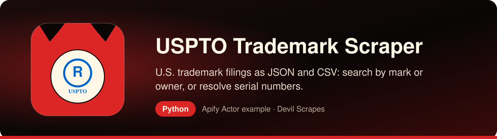

<p align="center"><a href="https://apify.com/DevilScrapes/uspto-trademark-scraper"></a></p>

# USPTO Trademark Scraper in Python: a company's U.S. marks in pandas, JSON and CSV

<p align="center">
<a href="https://apify.com/DevilScrapes/uspto-trademark-scraper"></a>

<a href="LICENSE"></a>
<a href="https://github.com/devilscrapes/uspto-trademark-scraper-python/actions/workflows/ci.yml"></a>
</p>

Here you will find a Python client, small and tested, for the **[USPTO Trademark Scraper](https://apify.com/DevilScrapes/uspto-trademark-scraper)** on Apify. Point it at a brand or company name such as `PATAGONIA`, or hand it a list of application serial numbers, and it returns one row per U.S. federal trademark with the fields a paralegal would otherwise copy out of TSDR by hand: status, the dates that matter, classes, goods, owner and attorney. The lookups run on Apify, so you need no USPTO developer key and no browser automation on your laptop. Output is written to `results.json` and `results.csv`, which load into a DataFrame in one line.

> **Actor:** [USPTO Trademark Scraper](https://apify.com/DevilScrapes/uspto-trademark-scraper) · **Publisher:** [Devil Scrapes](https://apify.com/DevilScrapes) · **Also in JavaScript:** [uspto-trademark-scraper-javascript](https://github.com/devilscrapes/uspto-trademark-scraper-javascript)

## 🔥 What you get

- **Three ways in, one row format**: a phrase searched against mark wording and owner names, a list of 8-digit application serial numbers, and a list of registration numbers can all go into the same run.
- **Forgiving number input**: anything that is not a digit is stripped, so `88/148,890` and `88148890` are the same request.
- **The prosecution essentials per mark**: current status text and its date, filing, publication and registration dates, register, Nice classes, goods and services wording, first-use dates, filing basis, owner, owner address and attorney of record.
- **Readable codes**: filing basis comes back as words like `USE_IN_COMMERCE`, `INTENT_TO_USE` or `MADRID_PROTOCOL` instead of `1(a)` and `66(a)`, and classes are zero-padded strings such as `025`.
- **Live/dead filter**: `statusFilter` keeps only marks whose status wording does or does not mention abandonment, cancellation or expiry.
- **A deep link for every row**: `tsdr_url` opens the mark's official case-status record, which is the page an attorney will ask for.
- **Polite by default**: number lookups are spaced about a second apart and throttling responses are retried with back-off, so long dockets finish without manual babysitting.

## 🎯 Use cases

### Map a company's U.S. trademark portfolio

Search the company name, keep the rows where `owner_name` is the exact legal entity, and pivot on `international_classes`. You get a class-by-class view of how many marks are live and how many were abandoned, which is a solid first page for brand-licensing or acquisition due diligence.

### Screen a proposed name before counsel does

Before a naming workshop ends, run the shortlisted words and read who already owns them, in which classes and on which register. It does not replace a clearance opinion, but it filters out the obvious conflicts while the whiteboard is still up.

### Watch maintenance deadlines across a docket

Feed every serial number in your portfolio once a month from cron. `registration_date` tells you when the Section 8 window between years five and six and the ten-year renewals fall due, and comparing `status` with last month's CSV flags anything that moved.

### Research filing behaviour in a market

Pull the marks for a group of competitors and compare filing basis, first-use dates and the goods wording they claim. Intent-to-use filings in a new class are often the earliest public hint that a company is about to launch a product line.

## ⚡ Quick start

You need an Apify account and an API token from [Console → Settings → Integrations](https://console.apify.com/settings/integrations). Apify's free plan includes monthly usage credit; this Actor's event prices are listed under Pricing below.

```bash
git clone https://github.com/devilscrapes/uspto-trademark-scraper-python.git
cd uspto-trademark-scraper-python
python -m venv .venv && source .venv/bin/activate
pip install -r requirements.txt
export APIFY_TOKEN=your_token_here
python main.py                      # uses input.json
python main.py my-input.json --out data --max-charge 2
```

The script starts the [USPTO Trademark Scraper](https://apify.com/DevilScrapes/uspto-trademark-scraper), waits for it to finish, prints a link to the run in Apify Console and saves every result to `results.json` and `results.csv`. It exits with code 1 and the run's status message if the run fails.

## 🧩 The core call

Strip away the command-line handling and the integration is these few lines: create a client, call the Actor with your input, iterate the dataset.

```python
from apify_client import ApifyClient

client = ApifyClient("YOUR_APIFY_TOKEN")
run = client.actor("DevilScrapes/uspto-trademark-scraper").call(run_input={'query': 'PATAGONIA', 'statusFilter': 'any', 'maxResults': 10, 'proxyConfiguration': {'useApifyProxy': False}})
for item in client.dataset(run.default_dataset_id).iterate_items():
    print(item)
```

## 📥 Input

`main.py` passes `input.json` through without changes. The example searches the phrase `PATAGONIA` and keeps up to ten matches whatever their status, a cheap first run. The phrase is matched against both the mark wording and the owner field, so a different company that uses the same word in its mark appears too; filter on `owner_name` afterwards. Swap in `serialNumbers` or `registrationNumbers` when you already know the marks you care about.

```json
{
  "query": "PATAGONIA",
  "statusFilter": "any",
  "maxResults": 10,
  "proxyConfiguration": {
    "useApifyProxy": false
  }
}
```

| Field | Type | Required | Default | Allowed values |
|---|---|---|---|---|
| `query` | string | no | `"BLINKING NAILS"` | — |
| `serialNumbers` | array | no | `["88148890"]` | — |
| `registrationNumbers` | array | no | `["5912174"]` | — |
| `statusFilter` | string | no | `"any"` | `any`, `live`, `dead` |
| `maxResults` | integer | no | `20` | — |
| `proxyConfiguration` | object | no | `{"useApifyProxy": false}` | — |

## 📤 Output

One dataset row stands for one application, keyed by `serial_number`. Search hits carry the first listed owner with the entity-type suffix removed, which makes exact matching on the company name practical, and their `status_date` is always empty; direct number lookups fill it in when TSDR shows one. If a mark is reached through both a number and the search phrase it is written twice, so de-duplicate on `serial_number`.

| Field | Type | Always present |
|---|---|---|
| `serial_number` | string | yes |
| `registration_number` | string or null | no |
| `mark_text` | string | yes |
| `mark_type` | string or null | no |
| `standard_character_claim` | boolean or null | no |
| `description_of_mark` | string or null | no |
| `status` | string or null | no |
| `status_date` | string or null | no |
| `filing_date` | string or null | no |
| `registration_date` | string or null | no |
| `publication_date` | string or null | no |
| `register` | string or null | no |
| `international_classes` | array | no |
| `goods_services` | string or null | no |
| `first_use_date` | string or null | no |
| `use_in_commerce_date` | string or null | no |
| `filing_basis` | array | no |
| `owner_name` | string or null | no |
| `owner_address` | string or null | no |
| `attorney_name` | string or null | no |
| `tsdr_url` | string | yes |
| `scraped_at` | string | yes |

## 💰 Pricing

| Event | Price (USD) |
|---|---|
| Actor start | $0.2 |
| Result emitted | $0.005 |

Prices as configured on 2026-08-20. The [Actor page](https://apify.com/DevilScrapes/uspto-trademark-scraper) always shows the current price. Runs are billed to the Apify account that owns the token. Use `--max-charge` to cap what a single run can cost.

## 🛠️ Working with the data in Python

This pandas example (`pip install pandas`) keeps only the marks owned by one legal entity, labels each as live or dead from its status wording, counts live marks per Nice class and lists the live registrations oldest first.

```python
import json

import pandas as pd

rows = pd.DataFrame(json.load(open("results.json", encoding="utf-8")))
rows = rows.drop_duplicates("serial_number")

company = "patagonia, inc."
mine = rows[rows["owner_name"].fillna("").str.casefold() == company].copy()
others = rows.loc[~rows.index.isin(mine.index), ["mark_text", "owner_name", "status"]]

dead_words = "ABANDONED|CANCELLED|EXPIRED|DEAD"
mine["live"] = ~mine["status"].fillna("").str.upper().str.contains(dead_words)
mine["registered"] = pd.to_datetime(mine["registration_date"], errors="coerce")

per_class = (
    mine.explode("international_classes")
    .groupby("international_classes")["live"]
    .agg(live="sum", total="count")
)
print(per_class.to_string())

live = mine[mine["live"]].sort_values("registered")
print(live[["serial_number", "registration_number", "mark_text", "registered", "status"]].to_string(index=False))
print(f"{len(others)} hit(s) belong to other owners")
mine.to_csv("portfolio.csv", index=False)
```

## ❓ FAQ

### How is this different from the official USPTO APIs?

USPTO's TSDR data API asks you to register for a key, and it starts from case numbers you already know. This Actor accepts a free-text phrase as well as number lists and gives back a flat table, and all you manage is an Apify token.

### Why does `statusFilter: live` sometimes return fewer rows than `maxResults`?

For phrase searches the Actor first takes the top `maxResults` hits and then removes the ones that do not match the filter. Ask for a larger `maxResults` if you want a full page of live marks.

### What happens when nothing matches?

Unknown numbers are logged and skipped. If the whole run ends with zero rows, it is marked as failed and its status message lists what was tried, so a cron job notices a typo instead of silently saving an empty file.

### Does it include logos, office actions or ownership transfers?

No. You get the case-status summary fields only. Drawings, specimens, office-action documents, assignment history and TTAB proceedings are separate USPTO record sets, and marks registered only outside the United States are not covered.

## 🧯 Troubleshooting

- **`Set APIFY_TOKEN first`**: export the token in the same shell, or put it in a local `.env` file your shell loads. Never commit it.
- **Run finished with `FAILED` or `ABORTED`**: open the printed Console link; the run log says why. Input validation errors name the field.
- **Fewer rows than expected**: a `--max-charge` cap also limits how many results can be charged. Raise the cap or lower the limits in your input.
- **Something looks wrong in the data**: open an issue on the [Actor page](https://apify.com/DevilScrapes/uspto-trademark-scraper) so the maintainers see it.

## 🔗 More from Devil Scrapes

- [USPTO Trademark Scraper on Apify Store](https://apify.com/DevilScrapes/uspto-trademark-scraper)
- [JavaScript version of this example](https://github.com/devilscrapes/uspto-trademark-scraper-javascript)
- [All Devil Scrapes Actors](https://apify.com/DevilScrapes)
- [Apify web scraping cookbook](https://github.com/devilscrapes/apify-web-scraping-cookbook)

Related Actors:

- [EUIPO Trademark Search Scraper](https://apify.com/DevilScrapes/euipo-trademark-search-scraper) — European Union and TMview marks for the same clearance or watch work.
- [Companies House UK Scraper](https://apify.com/DevilScrapes/companies-house-uk-scraper) — UK company records to confirm who stands behind an owner name.
- [SEC EDGAR Filings Scraper — 10-K, 10-Q & 8-K](https://apify.com/DevilScrapes/sec-edgar-filings-scraper) — annual reports and other filings from the U.S. companies that own the marks.

---

MIT licensed example code. The Actor itself runs on [Apify](https://apify.com/DevilScrapes/uspto-trademark-scraper) and is maintained by [Devil Scrapes](https://apify.com/DevilScrapes). Not affiliated with the United States Patent and Trademark Office (USPTO).
